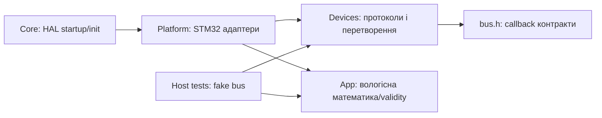

# Архітектура та походження

Core/Drivers ST і CMSIS з дозволеної SP-Boilerplate; LICENSE збережено.
ADC/SPI HAL доповнено з STMicroelectronics/stm32c0xx-hal-driver v1.0.1.
Platform має право включати HAL; Devices і App — тільки стандартну C-бібліотеку
та власні контракти. Автоматична перевірка tools/check_layers.py забороняє
HAL/CMSIS include у цих каталогах. main виконує bring-up, не містить формул датчиків.
Власні драйвери DHT/BMP/NTC/SD і тести пишуться під DewWindow; Arduino бібліотеки не використовуються.
HAL ADC — NTC; SPI — microSD; UART — лог; GPIO — DHT/LED/probes і I²C wire protocol.
Platform/gpio_i2c.c відпускає лінії входом із pull-up та керує лише LOW,
бо ізольовані проби C031 показали неправильний HIGH у OUTPUT_OD.
Drivers BMP180 не знають, чи використано hardware I²C або HAL GPIO адаптер.
Неактивний hardware I²C HAL вимкнено; у фінальному main немає його init.
RCC/PWR/CORTEX/FLASH — базова ініціалізація HAL; DMA типи потрібні заголовкам HAL;
EXTI обслуговує успадковану кнопку, у bring-up немає DMA передач.
Після ЛР2 не потрібне перенесення каталогів для ЛР3/4.
